# Practical 4: GitOps with Argo CD


**Aim:** Deploy an app to Kubernetes with GitOps. Argo CD pulls the desired state from GitHub and keeps the cluster matching it. This report shows Git-driven scaling, self-healing and pruning.

---

## 1. Check the cluster

The lab uses the existing 3-node Kind cluster `dso202` (1 control plane, 2 workers). All nodes are Ready.

```bash
kubectl get nodes
```

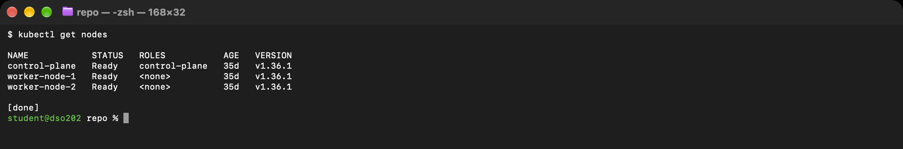

## 2. Install Argo CD

Argo CD was installed into its own `argocd` namespace. All 7 pods are Running.

```bash
kubectl get pods -n argocd
```

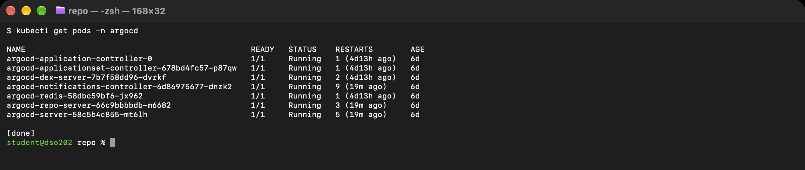

## 3. Log in to the Argo CD UI

The admin password was read from the `argocd-initial-admin-secret` secret (masked here). The UI was opened at https://localhost:8080 using `kubectl port-forward`.

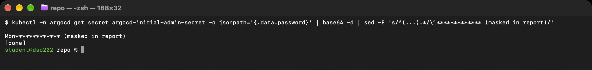

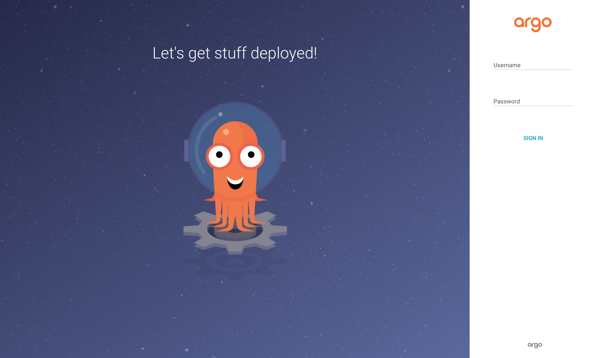

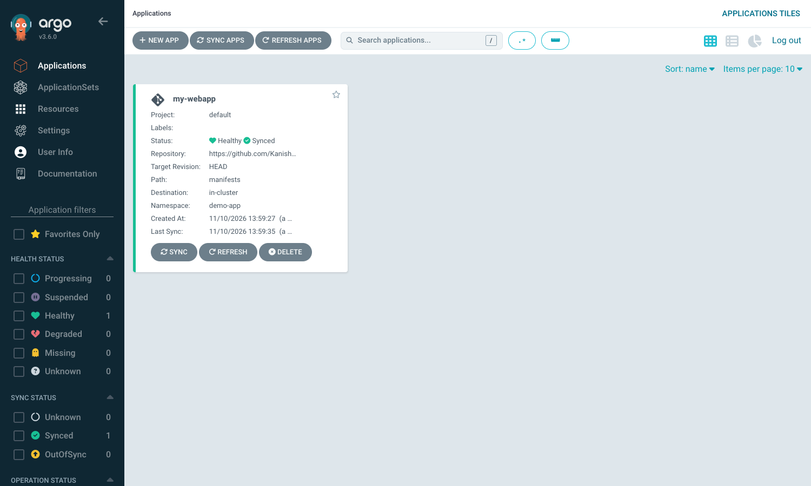

## 4. Put the desired state in GitHub

The two manifests (`deployment.yaml` with 2 replicas, and `service.yaml`) were put in a `manifests/` folder of my repo `DSO202-practical-04` and pushed to `main`.

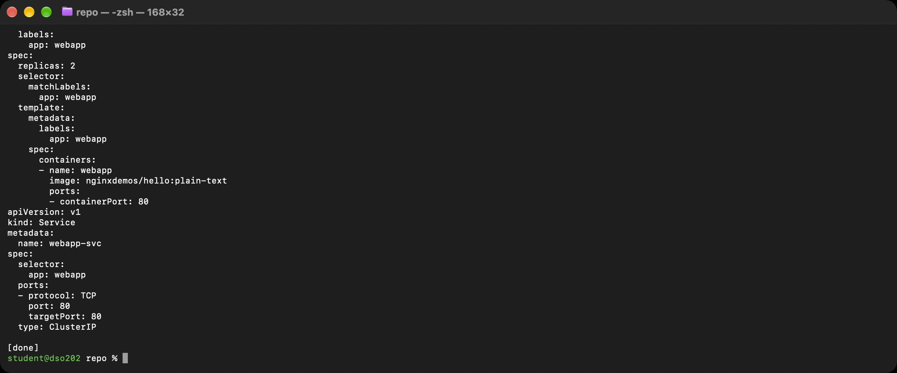

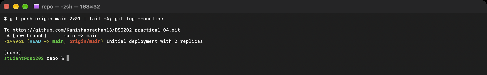

## 5. Register the application in Argo CD

A declarative Application (`argocd-app.yaml`) points Argo CD at the `manifests` folder, with automated sync, prune and self-heal turned on. Argo CD created the `demo-app` namespace and deployed 2 pods, one on each worker node.

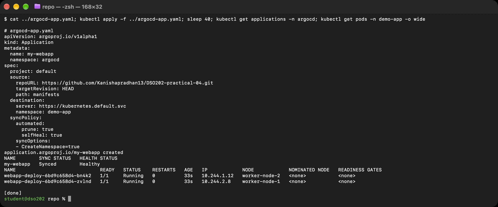

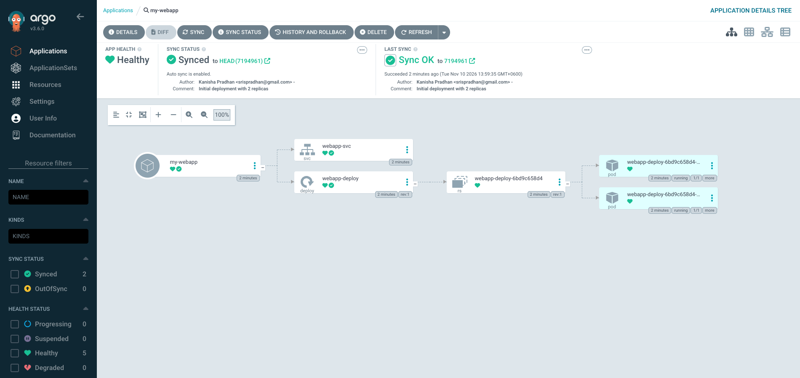

## 6. Experiment 1: Git is the source of truth

I changed `replicas: 2` to `replicas: 4` in Git and pushed. After a Refresh, Argo CD synced to the new commit and started 2 more pods. No `kubectl` was used to deploy.

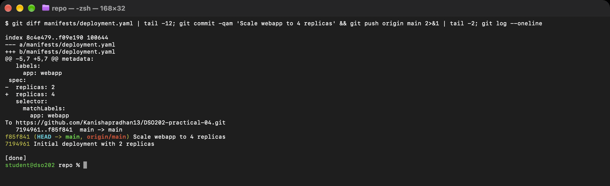


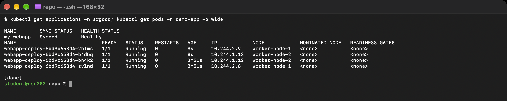

## 7. Experiment 2: Configuration drift and self-heal

I acted as a rogue admin and ran `kubectl scale ... --replicas=1`. Because `selfHeal: true`, Argo CD noticed the drift and restored 4 replicas within seconds (the 3 new pods are only 9s old).

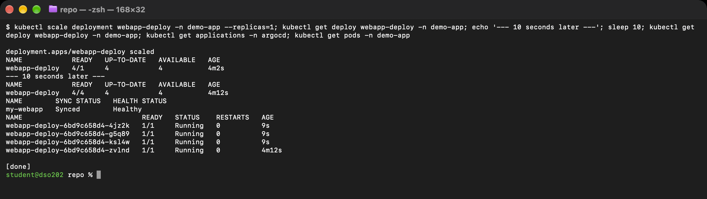


## 8. Experiment 3: Automatic pruning and revert

I deleted `service.yaml` from Git. With `prune: true`, Argo CD deleted the `webapp-svc` Service from the cluster. Then `git revert` brought the file back, and Argo CD recreated the Service.

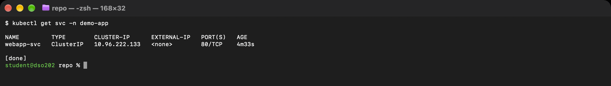

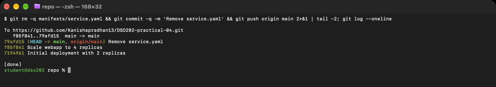

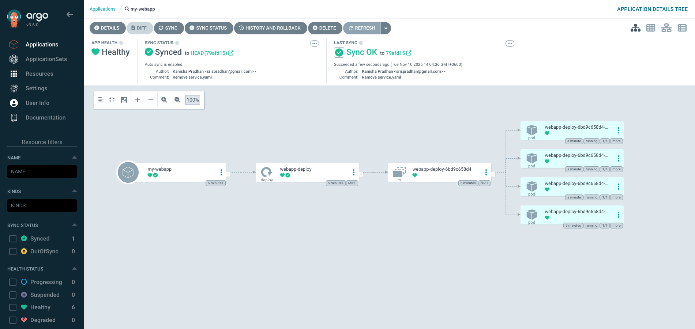

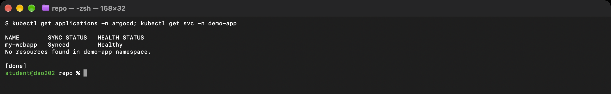

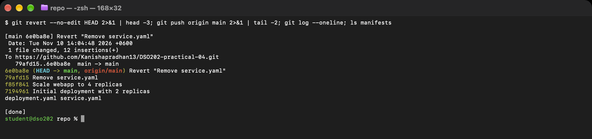

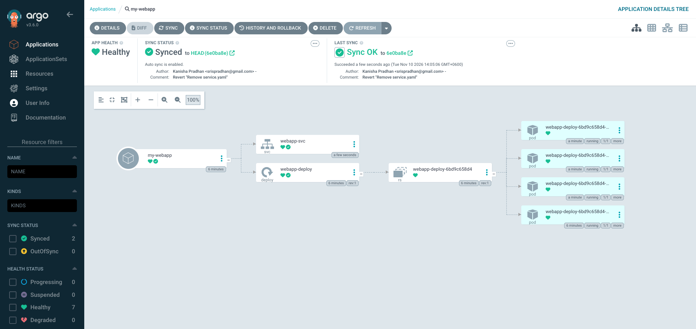

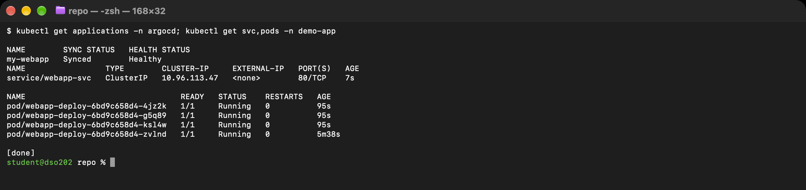

## Conclusion

Git was the single source of truth. Every change (scale, delete, revert) was a Git commit, and Argo CD applied it automatically. A manual change made with `kubectl` was undone by self-heal, and a file deleted from Git was pruned from the cluster.
